# Cyberpunk 2077 — SPARKY Protocol / Protocolo C.H.I.S.P.A. (`v2.0.0`)
### *Night City Survival Guide* — **v2.0 Live Local AI Companion** (`Ollama` + `F5-TTS`/`Kokoro-82M`, `162`-Card Hybrid RAG, Isolated Per-Save Memory, `[Y]`/`[U]` HUD Telemetry) + **Complete Season 1 Voiced Campaign** (`Ep. 0–5`, `7` Iconic Weapons, `3` RPG Endings)

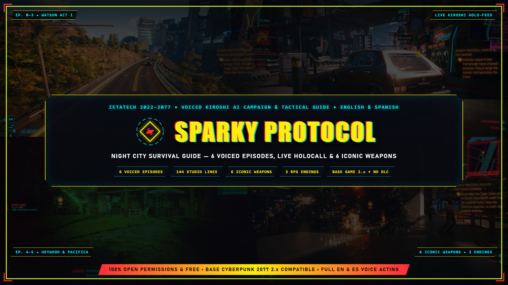

> **🌍 Navigation & Direct Downloads / Navegación y Descarga Directa (`v2.0.0`):**
> - 🧩 **[Nexus Mods Page (`cyberpunk2077/mods/38982`)](https://www.nexusmods.com/cyberpunk2077/mods/38982)**
> - 🎬 **[Watch v2.0.0 4K Live AI Showcase on YouTube (`youtu.be/oh9oSNnJVh0`)](https://youtu.be/oh9oSNnJVh0)** · **[Season 1 Trailer (`youtu.be/9MXEEu3NCcc`)](https://youtu.be/9MXEEu3NCcc)**
> - 📦 **[Download Release `v2.0.0` on GitHub](https://github.com/0utKast/cyberpunk2077-sparky-protocol/releases/tag/v2.0.0)**
>   - 🇺🇸 **`SparkyProtocol_EN_v2.0.0.zip`** — *Main Game Mod: 100% Pure English Standalone Edition*
>   - 🇪🇸 **`ChispaNC_v2.0.0.zip`** — *Mod Principal: Edición Española / Bilingüe (ES & EN)*
>   - 🤖 **`SPARKY_v2.0.0_LocalAI_Service_EN.zip`** — *Optional Live Local AI Bridge (EN: Ollama + F5-TTS/Kokoro + 162-card RAG)*
>   - 🤖 **`CHISPA_v2.0.0_LocalAI_Service_ES.zip`** — *Puente Opcional de IA Local en Vivo (ES: Ollama + F5-Spanish/Kokoro + RAG 162 fichas)*
>   - 🎙️ Optional Voice Packs: `SparkyProtocol_EN_FemaleVoicePack_v2.0.0.zip`, `Chispa_LocalAI_FemaleVoicePack_ES_v2.0.0.zip`, `ChispaNC_ClassicCampaignVoices_v2.0.0.zip`
> - 🇺🇸 **[English Documentation (v2.0 Local AI, Ep. 0–5 Campaign & Install)](#english-documentation)**
> - 🇪🇸 **[Documentación en Español (IA Local v2.0, Campaña Ep. 0–5 e Instalación)](#documentación-en-español)**
> - ⚖️ **[Credits & Open Modding Permissions (`CREDITS.md`)](CREDITS.md)** · 📜 **[MIT License (`LICENSE`)](LICENSE)**

---

# 🇺🇸 English Documentation

## 1. Overview
**SPARKY Protocol — Night City Survival Guide (`v2.0.0`)** (*Protocolo C.H.I.S.P.A.*) pairs a **6-episode voiced Season 1 campaign (`Ep. 0–5`)** with a **100% local, zero-cloud real-time AI companion (`S.P.A.R.K.Y.`)** integrated natively into V's Kiroshi HUD. Fully compatible with **Cyberpunk 2077 `2.x` Base Game** (no *Phantom Liberty* DLC required).

---

## 2. What's New in `v2.0.0` — Live Local AI Companion (`[Y]` / `[U]`)
- **Native HUD Kiroshi Neural Link Bar (`[Y]`) & Instant Tactical Scan (`[U]`):** Tap `[Y]` anytime in free roam or stealth to type freely without freezing the game (`[Tab]` inside the bar triggers an instant read; `[Up]` recalls your last prompt); tap `[U]` directly in gameplay to trigger a spoken breakdown of your district, active mission, scanned hostile, weapon, HP, and NCPD heat. Cleanly toggleable/rebindable via CET Bindings.
- **100% Offline Ollama LLM + Clause-by-Clause Streaming Voice:** Runs `gemma3:12b` (default with automatic NVML VRAM balancing on `<=16 GB` GPUs alongside 4K gameplay, or lighter `gemma3:4b`) streamed phrase-by-phrase into low-latency `F5-TTS` voice cloning (GPU) or zero-VRAM CPU `Kokoro-82M` sergeant blend over your chosen WASAPI output.
- **162-Card Offline Hybrid Lore RAG (`0 MB` Extra VRAM, `<5 ms` CPU Search):** Combines live Kiroshi telemetry pinning + `SQLite FTS5` + CPU ONNX dense vectors (`paraphrase-multilingual-MiniLM-L12-v2`) across **162 modular lore cards** (with custom JSON extensibility, strict 2022 vs. 2077 memory separation, and automatic Act 1 spoiler gating before *The Heist*).
- **Isolated Per-Playthrough Episodic Memory (`chispa_mem_uid`):** Every playthrough stamps a persistent `chispa_mem_uid` quest fact plus `playthrough_sec` timestamps so different characters/saves never leak history, loading earlier saves hides future timeline events, read Shards index automatically into long-term SQLite FTS5 memory, and an async background recap updates a compressed 1st-person run journal.
- **Spontaneous Reactions, Immersion Guards & Opt-In Wiki:** Toggle live in **SPARKY Studio** between `Tactical` (`<=28%` HP, NCPD/MaxTac 5★, boss/cyberpsycho scans, long firefights, district arrivals, quest progress), `Active Companion` (adds Shard comments & ambient road banter), or `Off`. Automatically pauses/mutes over vanilla calls, cutscenes, dialogue hubs, menus, and Shard readers. Online Fandom Wiki lookup is strictly **opt-in (disabled by default)**.
- **Standalone One-Click Installer & Auto Steam / GOG / Epic Detection:** Extracts anywhere (even outside the game folder), automatically detects Steam, GOG, and Epic Games installations (or `game_path.txt` / `--ipc-dir`), and sets up dependencies via `install_sparky_ai.bat`.

---

## 3. Season 1 Campaign (`Episodes 0–5`) & Technical Features
| Episode | Title & Location | Tactical Mechanics, Rewards & Lore |
| :--- | :--- | :--- |
| **Ep. 0** | *Not Your Office Paperclip* (`Megabuilding H10`, Watson) | Rescue S.P.A.R.K.Y. v0.98b, scan targets with Kiroshi `[TAB]`, overload the unstable industrial capacitor (`[F]`), claim `+1,500 €$`, Iconic pistol ***Executive Courtesy*** (`Lexington`), and unlock portable lore on Richard Night & Megabuildings. |
| **Ep. 1** | *Ghosts in the Camera* (`Kabuki Creek Promenade`, Watson) | Positioned cleanly off the roadway along the pedestrian walkway. Receive starter `Ping`, hijack chained cameras (`CAM-01 -> CAM-02`), detonate the Scav Entropy server or overload the red RABIDS relay bank (`[F]`), claim Sector #01 (`+2,200 €$` + adaptive quickhacks + Iconic SMG ***Phantom Frequency***), and explore Bartmoss, DataKrash & the Blackwall. |
| **Ep. 2** | *More Chrome Than Meat* (`Northside Docks`, Watson) | Subvert or rip off Maelstrom's perimeter security turret, purge the pressurized CHOOH2 regulator (`[F]`), recover Sector #02 (`+2,800 €$` + adaptive Reboot Optics + Iconic Tech rifle ***Piercing Clause*** `M-179e Achilles`), and discuss Maelstrom, Cyberpsychosis, & MaxTac. |
| **Ep. 3** | *Bullets That Bend Corners* (`South Quay`, Watson) | Live `HasSmartLink` optical bridge, Tyger Claws smart-deflecting ink (`OnSmartBulletDeflectedEvent`), invert the Arasaka IFF Jammer Pylon (`[F]`), and recover Sector #03 (`+3,400 €$` + adaptive Contagion + Iconic Smart SMG ***Executive Curve*** `Shingen`). |
| **Ep. 4** | *Honor, Scrap & Cardboard Patriots* (`Arroyo`, Heywood) | Unlocks automatically once Watson's police lockdown lifts (`HasLiftedWatsonLockdown`). Activate `CanSeeRicochetVisuals` trajectory bridge (`GetNumRicochetBounces()` telemetry), spike the ballistic relay into 6th Street's NUSA depot (`[F]`), and claim Sector #04 (`+4,200 €$` + Iconic ***Street Geometry*** `Masamune`). |
| **Ep. 5** | *Beyond the Blackwall* (`Coastview`, Pacifica) | Storm the Voodoo Boys cryo-node with chained cams, dual Smart + Ricochet bridges, and NetWatch containment purge (`[F]`). Claim Master Sector #05 (`+5,000 €$` + adaptive System Collapse + Iconic Tech pistol ***Firewall '22*** `Kenshin`), then choose among **3 Quest-Yellow RPG Endings** (*Autonomous Partner v1.0*, *N54 Data Leak* `+4,500 €$` + Cyberware Malfunction, or *Gunsmith Protocol* forging Iconic revolver ***Sergeant's Last Word*** `Overture`). |

### Core Engineering Highlights Included (`v1.5.1` – `v1.6.1` + `v2.0.0`)
- **Dual Optional Audio Backend (`AudioXL` + `Audioware`):** Works seamlessly on Windows, Linux, Proton, and Steam Deck via Redscript `@if(ModuleExists(...))` without duplicating `.ogg` files (and compiles cleanly in subtitle-only fallback mode if neither plugin is installed).
- **Level-2 & Tier-1 Cyberdeck Compatibility + Hardware RAM Bridge:** 10 adaptive quickhack tiers, clean non-program quest hardware tooltips (`+8` base RAM + `+3` per extracted Memory Sector up to `+23` bonus RAM), idempotent Level/Street Cred/Skill XP rewards, pause/menu subtitle sync, and 2-line UTF-8 pagination across 19 locales.
- **Persistent Top-Left Kiroshi Holo-Feed (`440×440`) & Zero Conflict Guarantees:** Never occupies Cyberware/Cosmetic slots, respects Prologue/Character Creation (`GameplayTier.Tier1_FullGameplay`), and leaves `[F]` world interactions responsive mid-combat.

---

## 4. In-Game Screenshot Showcase (`1920×1080`)

| Incoming Encrypted Kiroshi Holocall (Ep. 0) | Kiroshi Optical Hazard Scanning (H10 Backlot) |
| :---: | :---: |
| 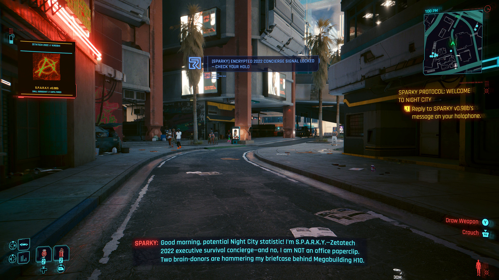 | 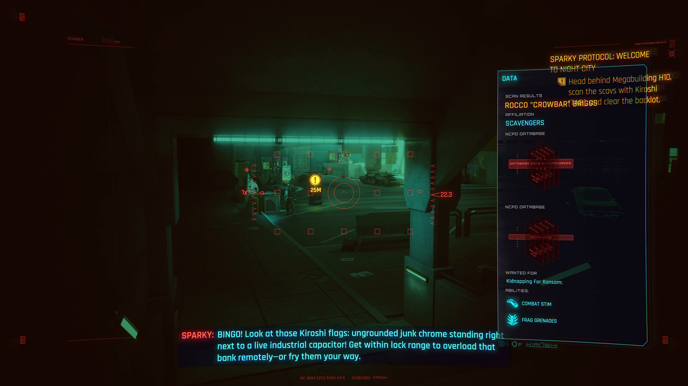 |
| **Chained Surveillance Camera Takeover (Ep. 1)** | **Deploying Ping Daemon Through Subnet (Ep. 1)** |
| 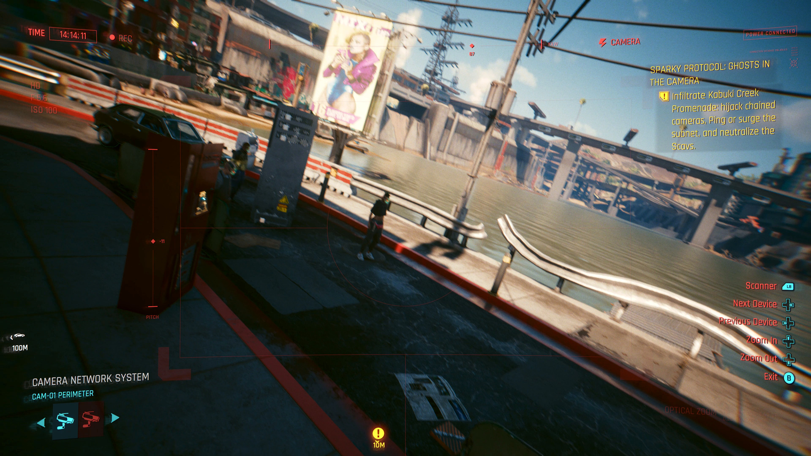 | 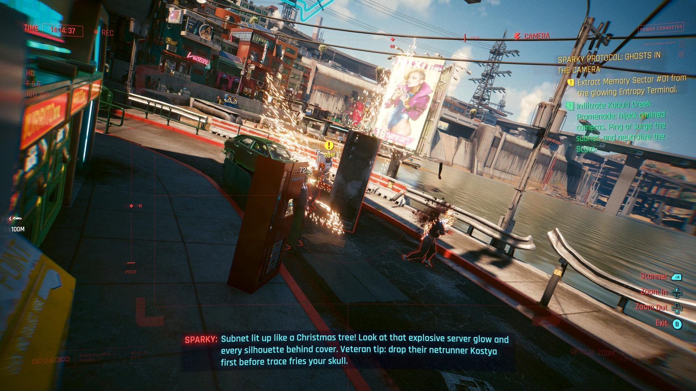 |
| **CHOOH2 Regulator Purge & Turret Override (Ep. 2)** | **Arasaka IFF Jammer Detonation (Ep. 3)** |
| 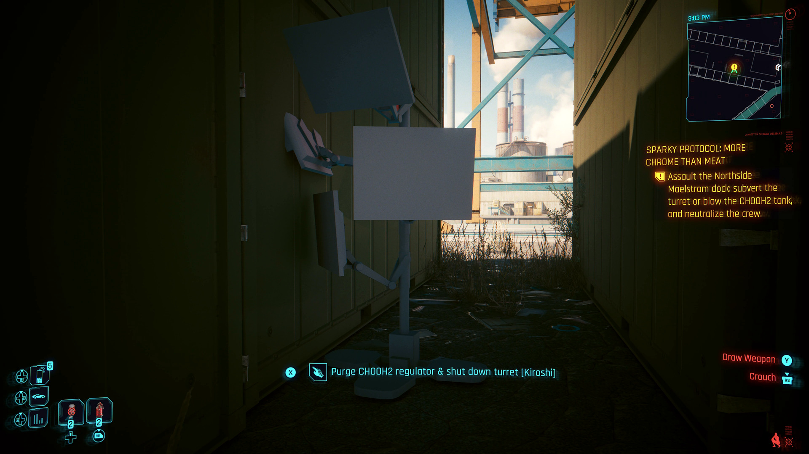 | 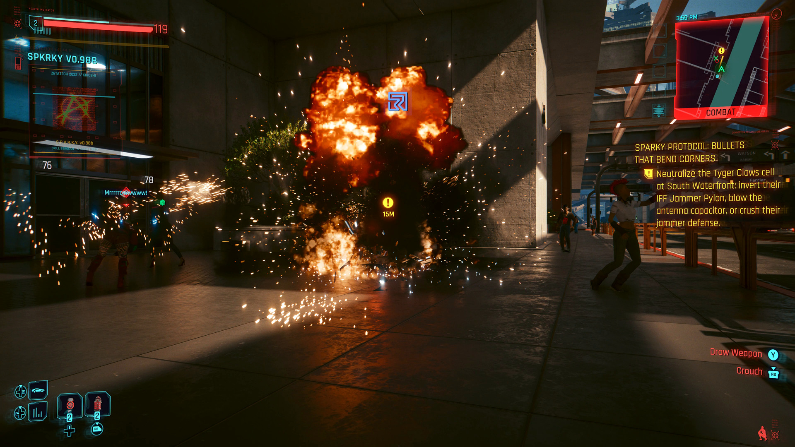 |
| **Pacifica Blackwall Containment Purge (Ep. 5)** | **Three Real Quest-Yellow RPG Endings (Finale)** |
| 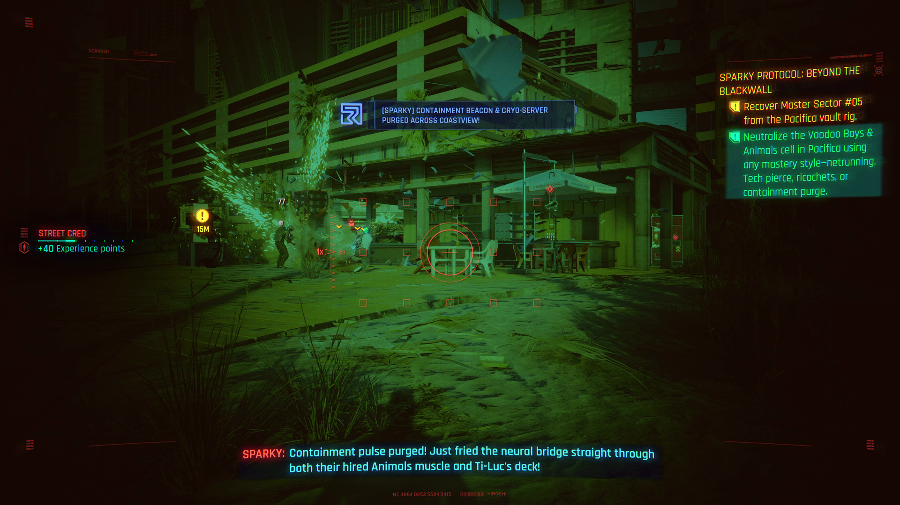 | 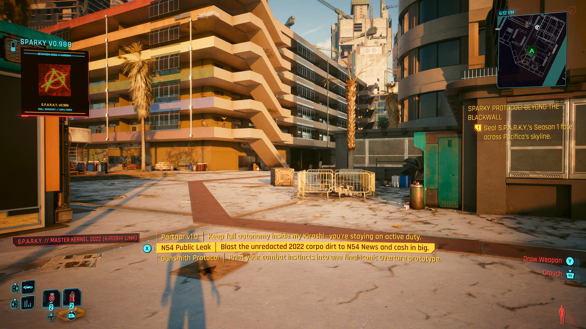 |

---

## 5. Compatibility, Requirements & Two-Step Installation
- **Game Version:** Cyberpunk 2077 `2.x` (**100% Base Game Compatible** — *Phantom Liberty* is **NOT** required).
- **Required Open-Source Frameworks** *(install separately; never bundled inside mod zips)*:
  [RED4ext](https://github.com/WopsS/RED4ext), [ArchiveXL](https://github.com/psiberx/cp2077-archive-xl), [TweakXL](https://github.com/psiberx/cp2077-tweak-xl), [Codeware](https://github.com/psiberx/cp2077-codeware), [redscript](https://github.com/jac3km4/redscript), [Cyber Engine Tweaks](https://github.com/maximegmd/CyberEngineTweaks), plus [AudioXL](https://www.nexusmods.com/cyberpunk2077/mods/33442) *(recommended Linux/Steam Deck & Windows)* OR [Audioware](https://github.com/cyb3rpsych0s1s/audioware) *(Windows)*.
- **Step 1 — Install ONE Main Game Edition:**
  1. Download **one** Main ZIP from [Nexus Mods #38982](https://www.nexusmods.com/cyberpunk2077/mods/38982) or [GitHub Releases (`v2.0.0`)](https://github.com/0utKast/cyberpunk2077-sparky-protocol/releases/tag/v2.0.0): **`SparkyProtocol_EN_v2.0.0.zip`** *(English)* OR **`ChispaNC_v2.0.0.zip`** *(Spanish/Bilingual)*.
  2. Install via **Vortex** / **Mod Organizer 2** or extract into your `Cyberpunk 2077` root folder. *(Never install both language editions together.)*
- **Step 2 — Optional Live Local AI Bridge (`v2.0.0` `[Y]` / `[U]` Features):**
  1. Install [Python 3.11 or 3.12](https://www.python.org/downloads/) and [Ollama](https://ollama.com/download).
  2. Download the matching Local AI ZIP (`SPARKY_v2.0.0_LocalAI_Service_EN.zip` or `CHISPA_v2.0.0_LocalAI_Service_ES.zip`), extract anywhere on your PC (auto-detects Steam/GOG/Epic), run **`install_sparky_ai.bat`** / **`instalar_chispa_ia.bat`**, configure audio/reactions in Studio, and leave **`start_sparky_service.bat`** / **`iniciar_servicio_chispa.bat`** open while playing.

---

## 6. Repository Architecture & Reproducible Build Pipeline

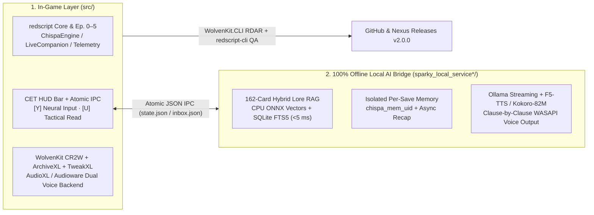

---

# 🇪🇸 Documentación en Español

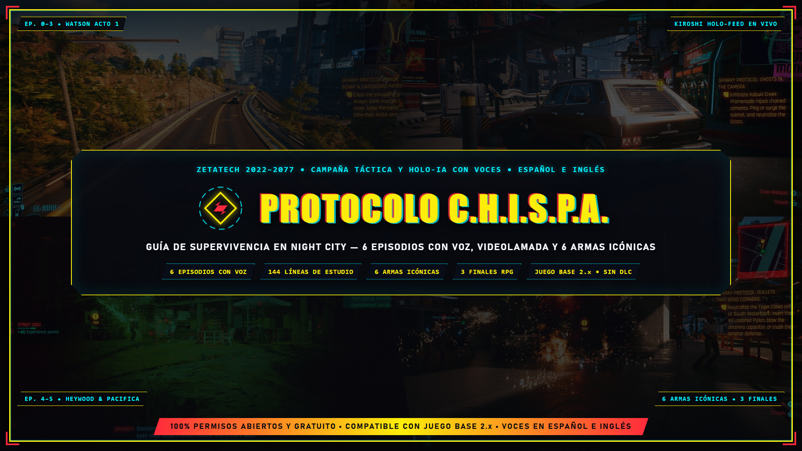

## 1. Descripción General (`v2.0.0`)
**Protocolo C.H.I.S.P.A. — Guía Callejera de Night City (`v2.0.0`)** (*SPARKY Protocol*) combina una **campaña narrativa doblada de 6 misiones (`Ep. 0–5`)** con un **compañero de IA local en tiempo real 100 % offline** (`[Y]` barra neural HUD + `[U]` parte táctico hablado), todo compatible al 100 % con el **Juego Base de Cyberpunk 2077 (`2.x`)** sin necesitar *Phantom Liberty*.

## 2. Novedades de la `v2.0.0` (Puente de IA Local en Directo)
- **Barra Neural Kiroshi (`[Y]`) y Réplica Táctica Instantánea (`[U]`):** Escribe cualquier pregunta en partida sin congelar el juego ni bloquear combates, o pulsa `[U]` para recibir análisis vivo por voz de tu distrito, misión, blanco escaneado, salud, arma y nivel NCPD.
- **Ollama 100 % Local + Voz Streaming (`F5-Spanish` / `Kokoro-82M`):** Usa `gemma3:12b` por defecto (o `gemma3:4b` en GPUs ligeras) locutando frase a frase con clonado `F5-Spanish` en GPU o mezcla `Kokoro` por CPU (`0 MB` VRAM extra).
- **Enciclopedia Híbrida Offline de `162` Fichas (`<5 ms` en CPU):** Anclaje Kiroshi + `SQLite FTS5` + vectores semánticos ONNX multilingües, perspectiva temporal `2022` vs. `2077` y escudo anti-spoilers automático en el Acto 1.
- **Memoria Episódica Aislada por Partida (`chispa_mem_uid`), Reacciones Espontáneas y Wiki Opcional:** Aíslas cada personaje y partida (`playthrough_sec`), eliges modo `Tácticas` / `Compañero Activo` / `Desactivadas` desde **Chispa Studio** y decides si autorizas consultas opcionales a la Wiki (desactivado por defecto).
- **Instalador en Un Clic y Detección Automática Steam / GOG / Epic:** Descomprime `CHISPA_v2.0.0_LocalAI_Service_ES.zip` en cualquier ruta y ejecuta `instalar_chispa_ia.bat`.

## 3. Campaña Temporada 1 (`Ep. 0–5`) e Instalación Rápida (Español)
1. **Mod Principal (elige solo uno):** Descarga **`ChispaNC_v2.0.0.zip`** *(Español/Bilingüe)* o **`SparkyProtocol_EN_v2.0.0.zip`** *(Inglés)* desde **[Nexus Mods #38982](https://www.nexusmods.com/cyberpunk2077/mods/38982)** o **[GitHub Releases (`v2.0.0`)](https://github.com/0utKast/cyberpunk2077-sparky-protocol/releases/tag/v2.0.0)**.
2. Instala los frameworks base (*RED4ext*, *ArchiveXL*, *TweakXL*, *Codeware*, *redscript*, *Cyber Engine Tweaks* y *AudioXL* o *Audioware*) y extrae el `.zip` en la raíz de **Cyberpunk 2077** (o mediante Vortex / MO2).
3. **(Opcional para IA Local v2.0):** Instala Python 3.11/3.12 + Ollama, descomprime **`CHISPA_v2.0.0_LocalAI_Service_ES.zip`** donde quieras, ejecuta `instalar_chispa_ia.bat`, ajusta tu audio en `probar_chispa_es.bat` y deja abierto `iniciar_servicio_chispa.bat` al jugar.
