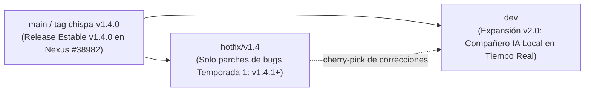
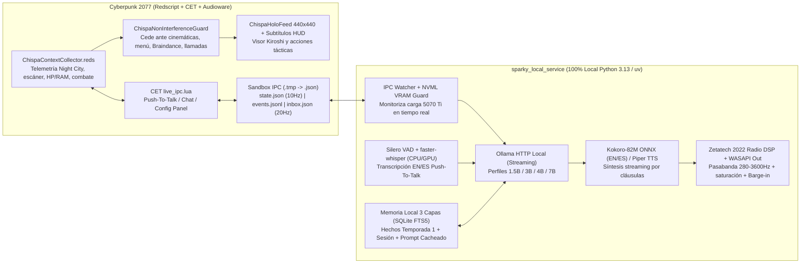
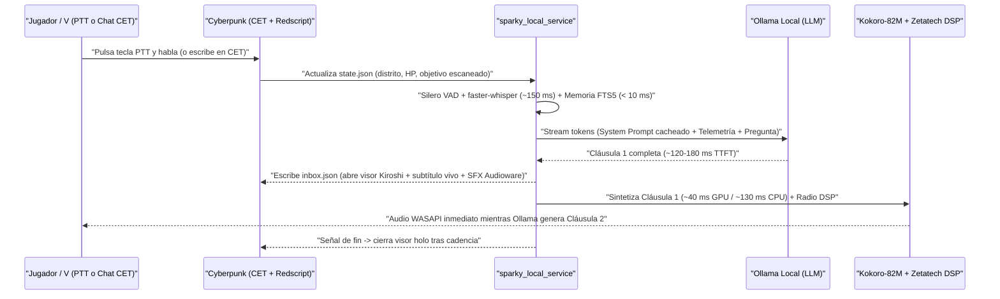

# Arquitectura e Infraestructura — SPARKY / C.H.I.S.P.A. v2.0 (Compañero Táctico IA 100 % Local en Tiempo Real)

> **Rama objetivo:** `dev` (derivada de la línea base publicada `v1.4.0` / `hotfix/v1.4` en [cyberpunk2077-sparky-protocol](https://github.com/0utKast/cyberpunk2077-sparky-protocol)).
> **Filosofía:** 100 % Offline/Local · Cero claves API en la nube · Cero dependencias DLL adicionales en el juego más allá de los 7 frameworks open-source de la `v1.4.0` · **100 % Permisos Abiertos (MIT)**.

---

## 1. Estrategia de Ramas Git y Mantenimiento Dual

Con la publicación de la **Temporada 1 Completa (`v1.4.0`)** en Nexus Mods (`#38982`) y GitHub, el proyecto queda estructurado en tres ramas claras tanto en el workspace local (`Mods_cyberpunk2077`) como en el repositorio público (`sparky_protocol` -> `0utKast/cyberpunk2077-sparky-protocol`):

| Rama | Propósito | Política de cambios |
| :--- | :--- | :--- |
| `main` | Código publicado en Nexus Mods y GitHub Releases | Solo recibe fusiones verificadas de `hotfix/v1.4.x` o el lanzamiento final `v2.0.0`. |
| `hotfix/v1.4` | Mantenimiento y soporte rápido de jugadores (`v1.4.x`) | Congelada sobre los Episodios 0–5 estáticos. Cualquier arreglo puntual se publica rápido sin arrastrar código experimental de `v2.0`. |
| `dev` | Desarrollo activo de la expansión `v2.0` en tiempo real | Toda la nueva infraestructura Python/ONNX/Ollama, puente IPC CET/Redscript, VAD/STT y memoria `SQLite FTS5`. |

---

## 2. Por qué esta Arquitectura: Límites Reales Verificados en REDengine 4

Antes de diseñar el flujo, se han verificado dos restricciones críticas del motor del juego y los frameworks instalados en `Cyberpunk 2077`:

1. **`Audioware` `HotReload()` no funciona en builds públicas (*Release*):**
   En `r6/scripts/Audioware/Natives.reds` (línea 8), el propio framework documenta: `/// (note: this function does nothing in release build)`. Audioware indexa sus manifiestos `.yaml` al arrancar el juego y no permite inyectar ni reproducir dinámicamente `.wav`/`.ogg` sintetizados segundo a segundo durante una partida viva sin reiniciar el proceso.
   - **Decisión de diseño:** Mantener **Audioware** para las 144 locuciones fijas de la Temporada 1 (`Ep. 0–5`) y para efectos tácticos instantáneos del visor (`ch_sfx_holo_hum`, `ch_sfx_call_in`), mientras que las **respuestas generadas en tiempo real** se transmiten cláusula a cláusula desde el servicio local (`sparky_local_service`) mediante un filtro **Zetatech 2022 Radio DSP** en Python hacia la salida estándar **Windows WASAPI (modo compartido)**.
   - **Ventaja doble:** Reduce el tiempo hasta el primer sonido (*TTFA*) de ~3,5 s (esperar frase entera + guardado en disco) a **`350–550 ms`**, y permite **corte inmediato (*barge-in* en `< 80 ms`)** si el jugador interrumpe a CHISPA/SPARKY hablando o si salta una cinemática nativa del juego.
   - **Control ambiental inteligente:** El servicio escala automáticamente su ganancia leyendo el volumen de voces reportado por el juego y se silencia/pausa al instante si `Cyberpunk2077.exe` pierde el foco de Windows, entra en menú de pausa o activa una escena/holollamada vanilla.

2. **Sandbox I/O de Lua en Cyber Engine Tweaks (`CET`):**
   CET restringe `io.open` y `os.rename` estrictamente a la subcarpeta propia del mod (`bin/x64/plugins/cyber_engine_tweaks/mods/ChispaNC/`). En lugar de obligar al jugador a instalar plugins C++ extra (como `RedFileSystem`), el puente de comunicación usa **IPC Atómico por Archivos dentro del Sandbox (`*.tmp` + `os.rename`)** en `mods/ChispaNC/ipc/`:
   - En Windows 11 con caché de páginas NTFS en RAM, el intercambio atómico de ficheros de `< 2 KB` tarda `< 0,05 ms`, garantiza lectura sin datos corruptos a medio escribir, tolera reinicios del daemon externo en caliente y mantiene el **listado exacto de los 7 frameworks base de `v1.4.0`**.

---

## 3. Diagrama de Arquitectura Completa (`Cyberpunk 2077` <-> `sparky_local_service`)

### Flujo de Baja Latencia en Conversación Real (`~350–550 ms` hasta el primer audio)

---

## 4. Diseño de Hardware y Perfiles Escalables (RTX 5070 Ti 4K + GPUs Modestas)

Tu equipo principal verificado dispone de:
- **GPU:** `NVIDIA GeForce RTX 5070 Ti` (`16.303 MiB` / `16 GB GDDR7` Blackwell, Driver `610.47`)
- **CPU:** `Intel Core i7-14700KF` (`20 núcleos / 28 hilos`)
- **RAM:** `32 GB` del sistema
- **Runtime ya instalado:** `Ollama 0.40.16`, `Python 3.13.17`, `uv`, `ffmpeg`

### Presupuesto de VRAM jugando/grabando Cyberpunk 2077 en 4K UHD (`3840x2160`)
Con el juego corriendo en **4K** (DLSS / Frame Gen / Ray Tracing), Cyberpunk + el compositor de Windows consumen habitualmente **`11,0 – 12,8 GB` de VRAM**, dejando **`3,2 – 5,0 GB` libres** en la GPU antes de invadir RAM compartida por PCIe (lo que provocaría caídas bruscas de *1% low* FPS).

Para garantizar **0 tirones en juego y grabación 4K** sin renunciar a máxima inteligencia en equipos con más margen, el daemon incluye un **Monitor Dinámico NVML (`VRAM Guard`)** y **4 perfiles seleccionables**:

| Perfil | Público objetivo | LLM Local (`Ollama` / compatible) | TTS (Voz EN & ES) | STT (Voz a Texto) | Presupuesto VRAM GPU |
| :--- | :--- | :--- | :--- | :--- | :--- |
| **`Tier S-Balanced` (Recomendado 5070 Ti 4K + RT)** | RTX 5070 Ti / 4080 / 5080 jugando en 4K con RT/PT activo | **`Qwen2.5-3B-Instruct` (`Q4_K_M`, ~2,2 GB)** o **`Gemma-3-4B-IT` (`Q4_K_M`, ~2,8 GB)** | **`Kokoro-82M ONNX`** en GPU CUDA/DirectML (`~300 MB`, `~40 ms`) o en CPU (`0 MB`) | **`faster-whisper` (`small`/`base` `int8`)** en CPU (E-cores `0 MB VRAM`, `< 180 ms`) | **`~2,5 – 3,1 GB`** *(Cero desbordamiento en 4K)* |
| **`Tier S-Max` (5070 Ti 1440p o Rasterizado 4K)** | RTX 5070 Ti / 16 GB+ con `>= 5,5 GB` de VRAM libre | **`Qwen2.5-7B-Instruct` (`Q4_K_M`, ~4,4 GB)** (mayor profundidad táctica y humor) | **`Kokoro-82M ONNX`** en GPU (`~300 MB`, `~40 ms`) | **`faster-whisper small` (`int8`)** en GPU o CPU | **`~4,7 – 5,0 GB`** *(Cambio automático a S-Balanced si VRAM libre < 4,5 GB)* |
| **`Tier A-Mid` (Gama Media `8–12 GB`)** | RTX 3060 / 4060 / 4070, AMD RX 6700–7800 | **`Qwen2.5-3B-Instruct`** o **`Llama-3.2-3B-Instruct`** (`~2,0 GB`, CUDA/ROCm/Vulkan) | **`Kokoro-82M ONNX (int8)`** en CPU o **DirectML** (compatible AMD/Intel/NVIDIA) | **`faster-whisper base (int8)`** en CPU (`0 MB`) | **`~2,0 GB`** |
| **`Tier B-Lite` (`4–6 GB` / CPU / Portátiles)** | GTX 1660, RTX 2060, Steam Deck, portátiles | **`Qwen2.5-1.5B-Instruct`** en CPU/RAM (`0 MB VRAM`) | **`Piper TTS` ONNX (`~60 MB`, `< 35 ms` en CPU)** con radio DSP *(+ fallback nativo Windows SAPI)* | **`faster-whisper tiny (int8)`** o chat por texto en CET | **`0 MB VRAM`** |
| **`Tier X-Custom` (Entusiasta)** | Equipos multi-GPU o servidores locales dedicados | Cualquier endpoint OpenAI-compatible (`LM Studio`, `llama-server`, Ollama remoto) | Adaptador enchufable (`Kokoro-FastAPI`, `Qwen3-TTS`, `Chatterbox`, `F5-TTS`) | Cualquier micrófono o API Whisper local | Configurable |

### Personalidad Vocal de CHISPA / SPARKY en Local (`Kokoro-82M` + `Piper` + `ZetatechRadioDSP`)
- **Inglés (`SPARKY`):** Fusión algebraica de vectores de estilo en Kokoro-ONNX (`0.65 * am_fenrir + 0.35 * am_adam` o `am_michael`, velocidad `1.07x`) combinando timbre rasposo de sargento con dicción militar firme.
- **Español (`C.H.I.S.P.A.`):** Perfil nativo `em_alex` (velocidad `1.08x`) calibrado en tono y cadencia.
- **Cadena `ZetatechRadioDSP` en tiempo real (`24 kHz`, estado continuo entre bloques):**
  1. Filtro paso banda Butterworth biquad **`280 Hz – 3600 Hz`** (compresión vocal telefónica/táctica estilo *walkie-talkie* de Kiroshi).
  2. Saturación armónica suave `tanh(drive * x)` y compresión RMS para mantener presencia sobre explosiones y disparos sin clipear.
  3. Reutilización del archivo `sfx/ch_sfx_call_in.ogg` vía Audioware al abrir un turno en vivo para mantener exactamente la misma firma sonora de la Temporada 1.

---

## 5. Integración Profunda en Cyberpunk 2077 (Sin Romper la Temporada 1)

### 5.1 Contratos de Datos del Puente IPC (`mods/ChispaNC/ipc/`)
1. **`state.json` (Escrito atómicamente por CET cada `100 ms` — `10 Hz`):**
   - `seq` (entero monótono), `timestamp_ms`, `lang` (`en-us` / `es-es`), `player_gender` (`Fem` / `Male`), `vo_volume` (`0.0..1.0`), `window_focused`.
   - `safe_to_speak` (`Bool`: falso automáticamente en Prólogo `q000`/`q001`, pantallas de carga, menú principal, pausa, *Braindance*, holollamadas vanilla de Jackie/Takemura/Panam o escenas de diálogo).
   - `player`: `district`, `subdistrict`, `hour`, `weather`, `hp_pct`, `armor`, `ram_cur`, `ram_max`, `in_combat`, `in_vehicle`, `ncpd_stars`, `equipped_weapon` (`name`, `type`: Tech/Smart/Power/Melee), `active_quest_title`, `active_objective`.
   - `scanner`: `is_scanning`, `target_name`, `target_faction`, `target_kind` (NPC / Camera / Turret / Explosive / AccessPoint), `target_threat`.
   - `campaign`: `chispa_ep00_done..chispa_ep05_done`, `chispa_ep05_ending` (`0`: sin terminar, `1`: *Socio Autónomo v1.0*, `2`: *Filtración N54*, `3`: *Protocolo Armero*).

2. **`events.jsonl` (Cola de sucesos puntuales desde el juego):**
   - `scan_target`, `combat_start`, `combat_end`, `enemy_kill_headshot`, `smart_deflect`, `ricochet_kill`, `quickhack_upload`, `low_hp_critical`, `district_changed`, `player_ptt_start`, `player_ptt_end`, `player_text_chat`, `hotkey_scan_remark`.

3. **`inbox.json` (Escrito atómicamente por `sparky_local_service` hacia el juego):**
   - `msg_id`, `state` (`speaking` / `chunk` / `done` / `idle`), `subtitle_text`, `show_holofeed` (`Bool`), `play_chime` (`Bool`), `tts_backend`, `llm_model`, `action_request` (acciones en whitelist ejecutables por `ChispaActionExecutor.reds`).

### 5.2 Acciones Tácticas Kiroshi Permitidas (*Whitelist* Segura)
Para que CHISPA no sea solo voz pasiva sino un verdadero copiloto táctico dentro del visor Kiroshi, el LLM puede emitir etiquetas estructuradas validadas en Redscript (con *cooldown* y confirmación opcional):
- `[ACTION:PING_PULSE]`: Lanza un barrido tipo *Ping* / resaltado óptico en el entorno inmediato.
- `[ACTION:MARK_NEAREST:RIPPERDOC | DROP_POINT | WEAPON_SHOP]`: Coloca un marcador GPS temporal en el minimapa hasta el servicio más cercano.
- `[ACTION:TOGGLE_OPTIC_BRIDGE:SMART | RICOCHET]`: Activa/desactiva temporalmente el puente óptico Smart o de trayectoria Power si el jugador completó el final *Socio Autónomo v1.0* en el Episodio 5.

### 5.3 Guardia Anti-Interferencia y Visor `440x440`
- Reutiliza el controlador probado `ChispaHoloFeed` (`440x440` en esquina superior izquierda `ZETATECH 2022 // KIROSHI`) de `v1.4.0` sin aplicar `PhoneCallRestriction` (V mantiene 100 % de movilidad, salto, cámara y combate).
- Si empieza un diálogo nativo del juego, una llamada de teléfono real del móvil de V o el jugador pulsa la tecla de interrupción / vuelve a usar *Push-To-Talk*, Redscript marca `safe_to_speak = false` y el daemon corta el stream WASAPI en `< 80 ms`.

---

## 6. Personalidad, Continuidad con Temporada 1 y Memoria Persistente

- **System Prompt Compacto y Cacheado en Ollama (`< 900` tokens):**
  Mantiene el *KV-cache* caliente en VRAM para que la primera respuesta entre en `< 150 ms`: sargento instructor táctico de Zetatech (2022) saboteado justo antes del DataKrash, ácido, directo, experto en historia real de Night City (Bartmoss, Muro Negro, Arasaka, Militech, bandas locales) y alérgico al vocabulario corporativo.
- **Continuidad narrativa automática según tu partida:**
  - Si aún no se ha completado el Episodio 5, recuerda las misiones ya superadas (`ep00..ep04`) y anima/regaña sobre el siguiente contrato pendiente.
  - Si ya terminaste la Temporada 1 (`chispa_ep05_done == 1`), adapta la relación al final exacto que elegiste (*Socio Autónomo v1.0*, *Filtración N54* o *Protocolo Armero*).
- **Memoria Local en 3 Capas (`SQLite FTS5` por partida/perfil de V):**
  1. **Memoria de Sesión (RAM):** Últimos 8 turnos de diálogo + eventos de los últimos 5 minutos.
  2. **Memoria Episódica Indexada (`SQLite FTS5`):** Hechos clave recordables (*«en Northside casi mueres contra Krag»*, *«te encantan los revólveres Overture»*, *«odias a los Hijos del Vudú»*), consultados en `< 5 ms` mediante BM25 antes de responder.
  3. **Estado Estático de Temporada 1:** Leído directamente de los `QuestsSystem` facts en `state.json`.

---

## 7. Hoja de Ruta por Fases (Desarrollo Incremental en Rama `dev`)

| Fase | Entregable verificable | Prueba de aceptación antes de avanzar |
| :--- | :--- | :--- |
| **Fase 1: Núcleo Local de Audio e IA (`sparky_local_service`)** | Servicio Python (`uv`) con `Ollama` streaming + particionador por cláusulas + `Kokoro-82M ONNX` (EN & ES) + `Piper` + `ZetatechRadioDSP` + salida WASAPI + `NVML VRAM Guard` | Probar en consola sin abrir el juego: hacer preguntas en español e inglés, oír la nueva voz de CHISPA/SPARKY con filtro de radio en **`< 550 ms`** hasta la primera sílaba y confirmar consumo de VRAM y corte inmediato (*barge-in*). |
| **Fase 2: Puente IPC y Visor Kiroshi en Vivo (`CET` + `Redscript`)** | Módulos `live_ipc.lua`, `ChispaContextCollector.reds` y `ChispaLiveCompanion.reds` conectados a `ChispaHoloFeed 440x440` y subtítulos HUD | Dentro de Cyberpunk 2077 en 4K: escribir un mensaje en el overlay CET o pulsar la tecla de comentario táctico al escanear un enemigo/distrito, y ver encenderse el visor top-left + subtítulo + voz sincronizada sin caídas de FPS ni cortes en diálogos vanilla. |
| **Fase 3: Entrada por Voz (`Push-To-Talk` + `Silero VAD` + `faster-whisper`)** | Captura de micrófono en hilo separado con detección automática de idioma EN/ES, *barge-in* real al pulsar PTT e idioma guiado por el juego | Hablar en directo mientras conduces o combates en Watson/Pacifica y recibir réplica táctica contextual de CHISPA en `< 0,8 s` totales tras soltar la tecla. |
| **Fase 4: Conciencia Autónoma, Memoria `FTS5` y Acciones Kiroshi** | Reacciones proactivas con *cooldowns* anti-spam (pocos PS, subida de estrellas NCPD, cambio de distrito, desvío Smart/rebote Power, jefes), memoria `SQLite FTS5` ligada al final Ep. 5 y acciones `[ACTION:*]` | Pasar una sesión larga recorriendo varios distritos y validar memoria entre reinicios, acciones tácticas Kiroshi en juego y respeto absoluto durante escenas vanilla. |
| **Fase 5: Instalador Automático, Panel de Perfiles y Release `v2.0.0`** | Script instalador/lanzador con `uv` (descarga limpia automática de Kokoro/Piper y comprobación de modelo en Ollama), pestaña de ajustes en CET y empaquetado standalone EN + ES (`v2.0.0`) | Verificación limpia de retrocompatibilidad con Temporada 1 (`Ep. 0–5`), pruebas en perfiles `Tier S`, `Tier A` y `Tier B`, auditoría WolvenKit / `redscript-cli` y actualización de documentación bilingüe. |
